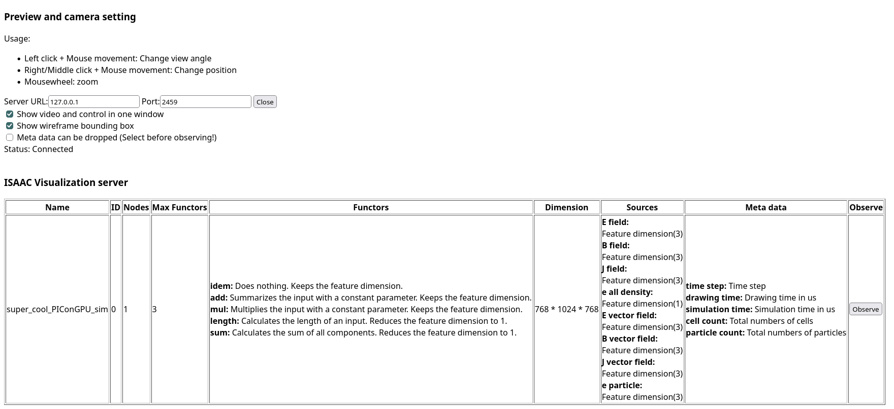
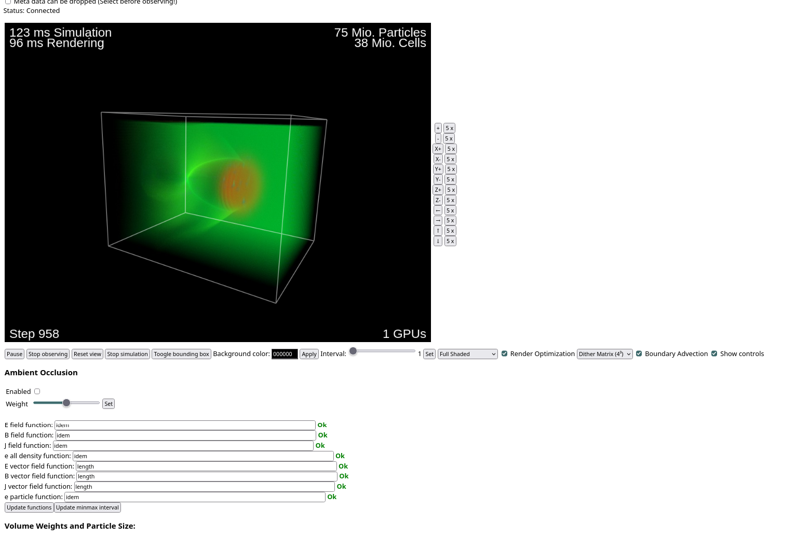
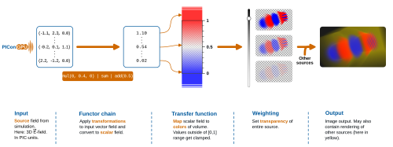

.. _usage-plugins-ISAAC:

ISAAC
-----

This is a plugin for the in-situ library ISAAC [Matthes2016]_ for a live rendering and steering of PIConGPU simulations.

External Dependencies
^^^^^^^^^^^^^^^^^^^^^

The plugin is available as soon as the :ref:`ISAAC library <install-dependencies>` is compiled in.

.cfg file
^^^^^^^^^

================================= ============================================================================
Command line option               Description
================================= ============================================================================
``--isaac.period N``              (*Required*) Sets up, that every *N* th timestep an image will be rendered.
                                  This parameter can be changed later with the controlling client.
``--isaac.name NAME``             Sets the *NAME* of the simulation, which is shown in the client.
``--isaac.url URL``               *URL* of the required and running ISAAC server.
                                  Host names and IPs are supported.
``--isaac.port PORT``             *PORT* of the ISAAC server.
                                  The default value is ``2460`` (for the in-situ plugins), but may need to
                                  be changed for tunneling reasons or if more than one server shall run on
                                  the very same hardware.
``--isaac.width WIDTH``           Sets up the *WIDTH* and *HEIGHT* of the created image(s).
``--isaac.height HEIGHT``         Default is ``1024x768``.
``--isaac.directPause BOOL``      If activated (argument set to ``1``) ISAAC will pause directly after the
                                  simulation started. Useful for presentations or if you don't want to miss
                                  the beginning of the simulation.
``--isaac.quality QUALITY``       Sets the *QUALITY* of the images, which are compressed right after creation.
                                  Values between ``1`` and ``100`` are possible.
                                  The default is ``90``, but ``70`` does also still produce decent results.
``--isaac.reconnect BOOL``        If activated (set to ``1``, is the default), ISAAC tries to reconnect to the
                                  server every rendered frame, in case the connection could not be established
                                  or was lost.
``--isaac.timingsFilename NAME``  Enable and write benchmark results into the given file.
================================= ============================================================================

The most important settings for ISAAC are ``--isaac.period``, ``--isaac.name`` and ``--isaac.url``.
A possible addition for your submission ``tbg`` file could be ``--isaac.period 1 --isaac.name !TBG_jobName --isaac.url YOUR_SERVER``, where the tbg variable ``!TBG_jobName`` is used as name and ``YOUR_SERVER`` needs to be set up by yourself.

.param file
^^^^^^^^^^^

The ISAAC Plugin has an :ref:`isaac.param <usage-params-plugins>`, which specifies which fields and particles are rendered.
This can be edited, but an arbitrary amount of fields (in ISAAC called *sources*) can also be deactivated at runtime.
At default, every field and every known particle species are rendered.

Running and steering a simulation
^^^^^^^^^^^^^^^^^^^^^^^^^^^^^^^^^

First of all, you need to build and run the `ISAAC server <https://computationalradiationphysics.github.io/isaac/doc/server/index.html>`_ somewhere.
On HPC systems, simply start the server on the head node, since it can be reached by all compute nodes (on which the PIConGPU clients will be running).
If the CPU time on the head node is limited, the server should be started from a dedicated CPU node.

In both cases, the connection from a client on your local machine must be tunneled to the system with the running server, possibly with a proxy jump.
You can follow the `Tunnel Guide <https://github.com/ComputationalRadiationPhysics/isaac/blob/dev/TUNNEL.md>`_,
which has instructions for one or multiple proxy jumps for different operating systems.
It also includes examples for tunneling to CPU nodes on the HZDR cluster **ROSI**.
If the tunneling worked, you should be able to connect your client to the server.

After the server was set up, its address needs to be inserted into the cfg file of your simulation (see ``--isaac.url`` flag above).
As the simulation usually runs in the same network as the server, you can just enter the name of the node (either compute node or head node) the server runs on.
If the node is not accessible via name, its IP address can be entered instead (can be found out via ``ip addr``).
When the simulation starts, it should show up in the list of active visualizations in your client, like in the following screenshot of the default web client.

When clicking on "Observe", the web client shows a window with the received images from the simulation.
You can steer the camera of the active simulation by dragging it directly in the window or by using the controls on the right, as seen in this image:

The client also allows you to change other settings, like the weights per source, iso-surface rendering, rendering of vector fields, clipping, and the classification via transfer functions.

Render pipeline
^^^^^^^^^^^^^^^

The pipeline for rendering PIConGPU field data as a volume in ISAAC is shown in the following image at the example of the electric field:

The usual workflow is to use the *Functor Chains* to transform your field data into the domain you want to visualize.
A more thorough explanation of the Functor Chains follows in the next section.
A *transfer function* is then used to map the field to the wanted colors and alpha values.
This process can be done for every individual field and species.

Other render methods than just glowing gas volumes are also available:

* Fields can also be rendered as solid iso-surfaces.
  In this case, the slider determines at which threshold of the alpha value the surface is rendered.
* Particle species can be rendered directly as sphere particles.
  The color of the particles represents their momentum.

Functor Chains
^^^^^^^^^^^^^^

One of the most important features of ISAAC are the **Functor Chains**.
As the domain of most sources (including fields) may not be suited for a direct rendering, the Functor Chains enable you to change the domain of your field source-wise.
Only values in the range [0,1] are mapped to a unique color through the *transfer function*.
Values outside this range are clamped to its boundaries, so the domain must be manipulated.
A date will be read from the field, the Functor Chain applied, and **only the x-component** will then be used for the classification and later rendering of the scene.

Multiple functors can be applied successively with the pipe symbol ``|``.
The number of maximum functors in a chain is by default limited to 3.
This limit can be increased before compiling, but will also increase the compile time significantly.
The possible functors are, by default:

* **mul** for a multiplication with a constant value.
  For vector fields, you can choose different values per component, e.g., ``mul(1,2,0)``, which will multiply the x-component with 1, the y-component with 2, and the z-component with 0.
  If less parameters are given than components exist, the last parameter will be used for all remaining components without an own parameter.
* **add** for adding a constant value, which works the same as ``mul(...)``.
* **sum** for summarizing all available components.
  Unlike ``mul(...)`` and ``add(...)``, this decreases the dimension of the data to ``1``, which is a scalar field.
  You can exploit this functor to use a different component than the x-component for the classification, e.g., with ``mul(0,1,0) | sum``.
  This will first multiply the x- and z-component with 0, but keep the y-component, and then merge this to a scalar (which is internally the x-component of a 1D vector).
* **length** for calculating the length of a vector field.
  Like `sum`, this functor reduces the dimension to a scalar field, too. However, ``mul(0,1,0) | length`` is not as efficient as ``mul(0,1,0) | sum``.
  As ``length`` does not know that the x- and z-components are 0, an expensive square root operation is performed, which is slower than just adding the components up.
* **idem** does nothing, it just returns the input data.
  This is the default functor chain.

Memory Complexity
^^^^^^^^^^^^^^^^^

Accelerator
"""""""""""

Locally, a framebuffer with full resolution and 4 byte per pixel is allocated.
For each ``FieldTmp`` derived field and ``FieldJ`` a copy is allocated, depending on the input in the :ref:`isaac.param <usage-params-plugins>` file.

Host
""""

negligible.

Example renderings
^^^^^^^^^^^^^^^^^^

.. image:: https://raw.githubusercontent.com/ComputationalRadiationPhysics/isaac/dev/example_renderings/picongpu_wakefield_8.png
   :alt: Laser Wakefield

.. image:: https://raw.githubusercontent.com/ComputationalRadiationPhysics/isaac/dev/example_renderings/picongpu_kelvin_helmholtz_4.png
   :alt: Kelvin Helmholtz Instability

.. image:: https://raw.githubusercontent.com/ComputationalRadiationPhysics/isaac/dev/example_renderings/picongpu_weibel_1.png
   :alt: Weibel Instability

References
^^^^^^^^^^

.. [Matthes2016]
        A. Matthes, A. Huebl, R. Widera, S. Grottel, S. Gumhold, and M. Bussmann
        *In situ, steerable, hardware-independent and data-structure agnostic visualization with ISAAC*,
        Supercomputing Frontiers and Innovations 3.4, pp. 30-48, (2016),
        `arXiv:1611.09048 <https://arxiv.org/abs/1611.09048>`_, `DOI:10.14529/jsfi160403 <https://doi.org/10.14529/jsfi160403>`_
